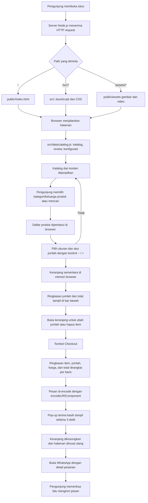
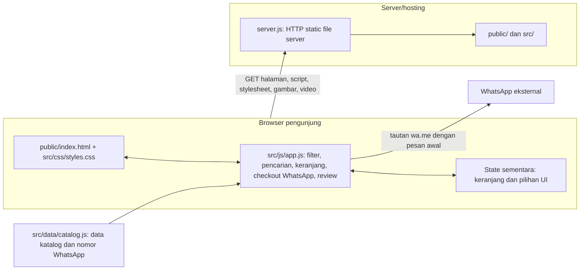

# Alur Sistem FD Culinary Saat Ini

Dokumen ini menggambarkan implementasi yang ada di repositori: katalog statis, server Node.js untuk menyajikan file, dan alur pemesanan yang berakhir di WhatsApp. Sistem saat ini tidak memiliki API, database, maupun pemrosesan pesanan di server.

## 1. Alur pengguna dan pemesanan

## 2. Komponen dan batas sistem

## Catatan perilaku saat ini

- `server.js` hanya melayani file statis. Request `/` diarahkan ke `public/index.html`; file `/src/*` disajikan dari folder `src`, dan aset lain dari `public`.
- Data produk, ulasan, nomor WhatsApp, dan sumber video berada di `src/data/catalog.js`.
- Pencarian, filter, pengatur jumlah pada kartu, dan keranjang dijalankan di browser. Keranjang disimpan dalam `Map` di memori, sehingga tidak tersimpan setelah halaman dimuat ulang.
- Saat keranjang berisi produk, ringkasan item dan total beserta tombol **Lihat keranjang** muncul tetap di bagian bawah layar.
- Tombol **Checkout** merangkai nama produk, ukuran, jumlah, total tiap produk, dan total pesanan menjadi pesan berbaris. Pesan di-encode dengan `encodeURIComponent` sebelum ditambahkan ke tautan WhatsApp.
- Setelah checkout, pop-up ucapan terima kasih tampil selama 3 detik. Keranjang dikosongkan, halaman dimuat ulang, lalu browser beralih ke WhatsApp membawa detail pesanan.
- Checkout membuka percakapan WhatsApp yang dituju. Pelanggan memeriksa detail pesanan lalu mengirim pesan sendiri; pesanan tidak disimpan di server.
